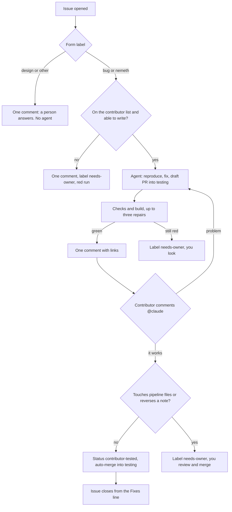

# The contributor fix pipeline

This page has two halves. The first is for a contributor who found a bug. The
second is for the maintainer. It is written in short plain sentences because it
is read aloud.

## If you found a bug

You never need to leave your issue. Everything happens there.

Open a new issue and pick the form that fits.

| Form | Use it when | Who works on it |
|---|---|---|
| Bug report | Something the app says it does is missing or broken. | An agent |
| Nemeth or speech | A Nemeth Code symbol or rule is missing, or you want an equation spoken in other words. | An agent |
| Design | You want something new, or want the app to feel different. | A person |
| Other | It is none of the above. | A person |

An agent works on the first two. A person answers the last two, on your issue.

Each event on your issue gets one comment. No comment repeats another. Every
comment has something new in it.

Within a minute you get a short comment that says work has started. You do not
need to do anything. About an hour later you get a second comment. It says what
changed. It has two download links, one for Mac and one for Windows. Install the
build and try the thing that was broken. You are the only person who can say
whether the bug is gone.

- If it is still wrong, write a comment that starts with `@claude` and say what
  you found. You get one new comment, and the same links already in the first
  one now hold the new build.
- If it works, write `@claude it works`. The maintainer then reads the fix and
  ships it.
- Do not close the issue. Closing sends nothing. You will get a comment that
  tells you what to write instead.
- If you have a question, start it with `@claude` too. You get one answer, and
  nothing changes.

The word `@claude` is what starts the work. A comment without it is read by
people only. Each run costs the maintainer part of a paid quota.

Sometimes the agent asks you up to three short questions first. Answer in a
comment that starts with `@claude`. "I do not know" is a good answer. A comment
may also say that the maintainer needs to look at a technical problem. Then you
need to do nothing. The maintainer will write here when there is news.

## If you maintain this repository

`testing` is the default branch. The prompts, tools, gates, allowlist and forms
all live on it. Changing the pipeline is an ordinary change into `testing`.
A fix merges by itself only when the contributor says it works, every required
check is green, and the fix touches no pipeline file. Any other fix waits for you.
The pipeline uses no `--admin` flag anywhere.

### The flow

### Rules

1. One comment per event. The agent never posts. Its job holds `issues: read`.
   It writes `message.md`, and `scripts/ci/reply.mjs` posts it once. An edit sends
   no notification, so nothing is edited. The agent's text is untrusted: it
   travels through `env`, is cut to 2000 characters, and loses links, `@` and HTML.
2. Only the maintainer decides what the app does. Three locks hold this.
   - Lock 1, the prompt. The agent classifies a report first. New behaviour gets
     `needs-design`, one comment and no code. A missing Nemeth symbol, and how
     math is spoken, are not design decisions. The agent does those.
   - Lock 2, `pipeline-followup.yml`. A contributor's comment resumes a fix only
     with `needs-info`, a real question from the bot, and no `needs-design`. The
     owner's own `@claude` comment lifts it. GitHub sets `author_association`, so
     it cannot be faked. That one comment is headed with a random token, so a
     contributor cannot write the heading.
   - Lock 3, the merge. The ruleset `testing-tested` needs the commit status
     `contributor-tested`. Only the hand-off job (`scripts/ci/hand-off.mjs`) sets it,
     with the App's token, and only after the contributor says it works. A fix that touches `.github/**`,
     `scripts/ci/**`, `CODEOWNERS` or `.github/contributors.yml`, that has a
     or that says "Reverses a standing note" gets `needs-owner` and no
     status. Only you merge those. A fix that conflicts is not one of them: it is
     brought up to date, and the contributor tries the new build. The agent's token has no Commit statuses permission.
3. Only people on `.github/contributors.yml` can start a run. The check is
   `scripts/ci/allowlist.mjs`. It fails closed. It runs before anything is installed.
   The person must also have write access (`scripts/ci/can-run-agent.mjs`).
4. The agent's tools are unrestricted Bash. The allowlist is what contains it.
   No job holds `actions: write`.
5. Long text stays out of `${{ }}`. GitHub rejects an expression over 21,000
   characters. The agent's instructions are in `.github/prompts/agent.md`. The
   workflow copies that file from `origin/testing` to a place outside the
   checkout, and the agent reads only that copy. A fix branch cannot rewrite them.
6. The agent works with a GitHub App token, not the built-in token. A pull
   request opened with the built-in token gets no checks. One opened by the App
   gets them the normal way, so `pipeline-verify.yml` only waits for them. A
   pull request that conflicts with `testing` gets no checks, so verify reports it
   as red and the repair agent merges `testing` in. The App
   has Contents and Pull requests write and Issues read. It has no Workflows,
   Checks or Administration permission, so it cannot change a workflow file. The
   App ID is the variable `PIPELINE_APP_ID` and the key is the secret
   `PIPELINE_APP_PRIVATE_KEY`. Never add a skip condition to `unit`, `nemeth` or
   `e2e`: a skipped job satisfies a required check.
7. Every run uses your Claude subscription (`CLAUDE_CODE_OAUTH_TOKEN`). There is
   no API key input, and a test fails if one appears.

### Labels

| Label | Meaning | Set by |
|---|---|---|
| `bug`, `nemeth`, `design`, `other` | The form chosen. `scripts/ci/issue-kind.mjs` reads it. Both `design` and `nemeth` means a person decides. | The issue form. Create these once by hand |
| `needs-info` | The agent asked a question and waits | The pipeline |
| `needs-design` | A person must decide | The agent |
| `needs-owner` | You must look: blocked, red checks, no access, or a fix that cannot merge by itself | The pipeline |

### The workflows

| File | Lives on | What it does |
|---|---|---|
| `.github/workflows/pipeline-fix.yml` | `testing` | An opened issue, or by hand with an issue number. Issue to draft pull request. |
| `.github/workflows/pipeline-followup.yml` | `testing` | An `@claude` comment on an issue. A revision, an answer or a hand-off. By hand with an issue number and a comment, for a rehearsal. |
| `.github/workflows/pipeline-agent.yml` | `testing` | The one place an agent runs. Modes `fix`, `comment`, `checks-failed`. |
| `.github/workflows/pipeline-verify.yml` | `testing` | Checks and builds the branch, repairs it up to three times, reports on the issue. |
| `.github/workflows/pipeline-rescued.yml` | `testing` | A person fixed a fix the pipeline gave up on. When the checks and the build go green, the contributor gets the test build on the issue, once. |
| `.github/workflows/pipeline-keep-current.yml` | `testing` | Every push to `testing`, weekly, and when a hand-off finds a conflict. Updates open fix branches. A conflict goes to the repair agent, in a manual run the push starts: the agent refuses a push, and accepts the Actions bot only for a manual run. |
| `.github/workflows/pipeline-ship.yml` | `testing` | By hand, from a chat session, after the owner says "ship it". Merges a `pipeline/` pull request that changed the automation. It replaces the bypass tick. |
| `.github/workflows/pipeline-signoff.yml` | `testing` | A closed issue with a fix still open gets one comment: closing sends nothing. |
| `.github/workflows/pr-checks.yml` | `testing` | The gates `unit`, `nemeth` and `e2e`. |
| `.github/workflows/pr-build.yml` | `testing` | A per-pull-request build to install. |
| `.github/workflows/testing-app.yml` | `testing` | Every push to `testing` publishes the alpha build. A merge reaches testers. |
| `.github/workflows/diagnostics-windows.yml` | `testing` | The braille diagnostics e2e on Windows. |
| `.github/workflows/screen-reader.yml` | `testing` | VoiceOver and NVDA against the editor, with transcripts. |

### Shipping a change to the automation itself

You describe the change in the chat. The session builds it, rehearses what it
can, and ships it with
`gh workflow run pipeline-ship.yml --ref testing -f pr_number=<N> -f sha=<head>`.
How much it needs from you depends on what the change touches.

| Tier | The change touches | What it needs |
|---|---|---|
| Automatic | Docs, prompts, tests, ordinary scripts and workflows | Nothing. It merges when green. |
| Ship it | A secret, a token, a write permission, an environment, a release, a delete or force, a trigger that runs with secrets, or a file that defines green or who may merge | Your words, passed as `owner_said` and written to the run summary. The workflow cannot prove you typed them. |
| Bypass tick | The shipper itself, the app, `package.json`, CODEOWNERS | Your click in the browser. A session cannot open this one. |

Always required: it runs from `testing`, started by you or the session account.
The branch starts with `pipeline/`. Only you and the session account pushed to it.
The checks `unit`, `nemeth`, `e2e` and both builds are green on that exact commit,
as jobs of `pr-checks.yml` and `pr-build.yml`. No test is deleted or moved.
Every file is on the allow list, and the changed lines of workflows and scripts
are read, because a list of bad files is never complete. The protected files are listed
in `scripts/ci/protection.json`. A test fails when a new sensitive line appears in a
file that is not allowed to hold one. `node scripts/ci/protection-report.mjs` shows each file.

### Setting up, adding a contributor, and getting unstuck

- Set up once: run `claude setup-token`, then add the result as the secret
  `CLAUDE_CODE_OAUTH_TOKEN` in the environment `pipeline` (see Secrets below).
- Secrets: `CLAUDE_CODE_OAUTH_TOKEN` and `PIPELINE_APP_PRIVATE_KEY` live only in
  the environment `pipeline`, whose deployment branches allow only `testing`. A
  workflow on any other branch cannot read them. There must be no repository-level
  copy of either. Callers pass both by name, and the value passed is empty on
  purpose; the called job reads the environment's value. The App needs Contents RW, Pull requests RW, Issues read and
  Commit statuses RW. The ruleset requires `contributor-tested` from the App.
- Add a contributor: `node scripts/ci/add-contributor.mjs <handle>`. It opens a
  pull request that adds the handle to `.github/contributors.yml`, and invites them
  as a collaborator. Merge it, and they accept the invitation. Use `--dry-run`
  first. To remove one, delete their line in a pull request.
- A report started nothing: open the Actions tab, choose `pipeline-fix`, press
  "Run workflow", and type the issue number. It is gated by who wrote the issue.
- An issue is stuck on `needs-design` or `needs-info`: write `@claude` yourself on
  the issue, or run `pipeline-fix` by hand. Your comment is the decision.
- A contributor has no write access: `needs-owner` is set and the run is red.
  Run `add-contributor.mjs` again, ask them to accept, then run `pipeline-fix`.
- Checks stay red after three repairs: the pull request gets `needs-owner` and a
  technical comment. Read it. It may say a check is wrong. That change is yours.
- A fix whose body says "Reverses a standing note" never merges by itself. Read
  that section first. The contributor can only say the bug is gone. They cannot
  see what was removed.
- Rehearse a change to the pipeline: `pipeline-fix.yml` and `pipeline-followup.yml`
  take inputs by hand. See `.claude/skills/pipeline-change/SKILL.md`. A rehearsal
  from a branch cannot run the agent or the hand-off, because the environment
  `pipeline` refuses any ref but `testing`. Those are seen live after the merge.
